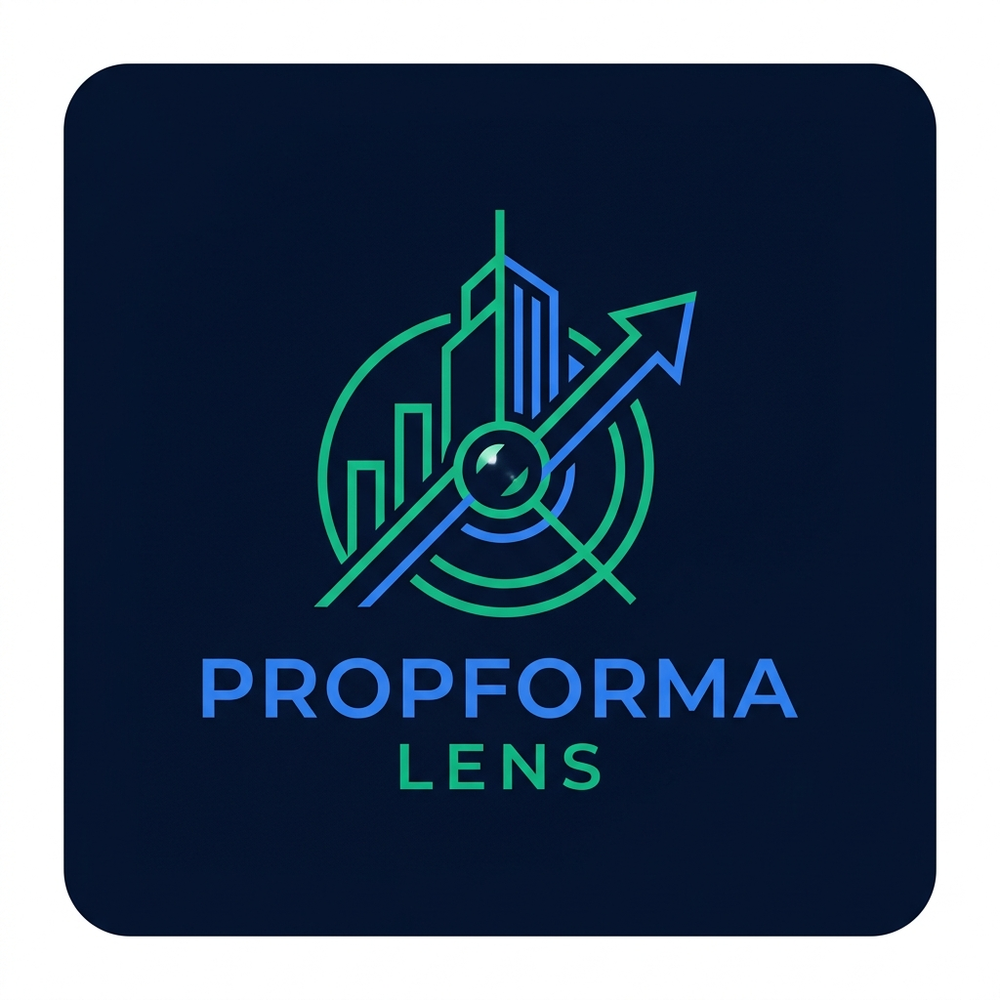
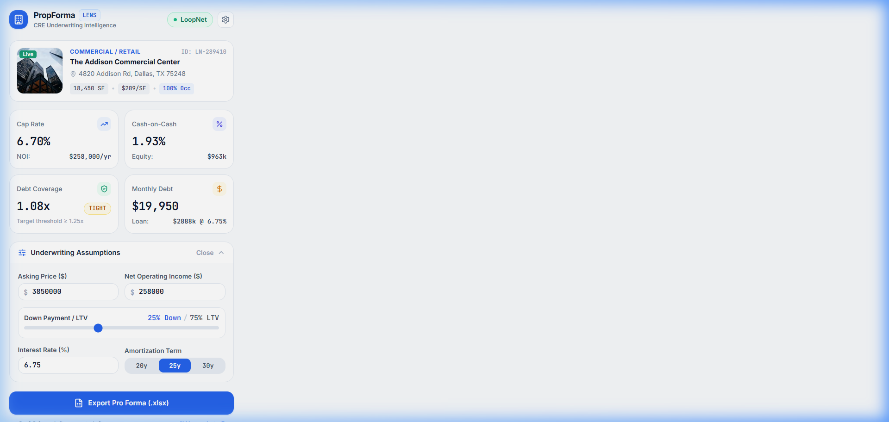
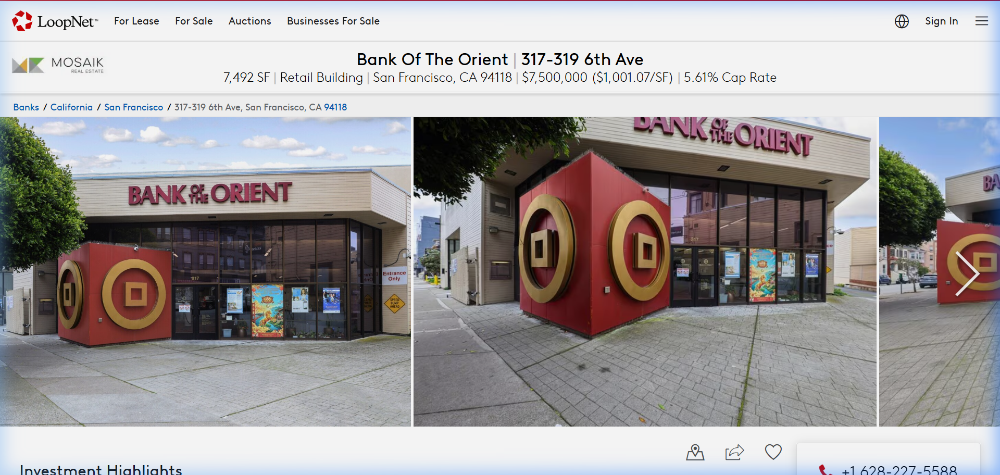

# PropForma Lens — Commercial Real Estate (CRE) Underwriting Intelligence

**Instant 1-Click Institutional Pro Forma Excel Models from LoopNet & Crexi.**

[-navy)](#)

---

---

## Executive Overview

**PropForma Lens** is a specialized financial productivity Chrome Extension built for **commercial real estate (CRE) acquisition analysts, investment brokers, private equity principals, and syndicate investors**.

Underwriting commercial real estate deals on portals like **LoopNet** and **Crexi** traditionally takes 30 to 45 minutes of manual copy-pasting into disconnected Excel templates. PropForma Lens collapses that entire underwriting workflow down to **one single click**.

While browsing any commercial property listing on LoopNet or Crexi, PropForma instantly extracts property specifications, financial benchmarks, pricing, and rent rolls. It generates an **institutional-grade, 3-sheet Wall Street underwriting workbook (`.xlsx`)** equipped with live banking formulas, dynamic debt service schedules, and 10-year compounding cash flow projections.

---

## Visual Showcase

<table>
  <tr>
    <td width="50%" align="center">
      <b>In-Browser Real Estate Popup & Triage Scoreboard</b> 
      <i>Reactive DSCR, Cap Rate, Loan Amortization & Cash-on-Cash</i>  
      
    </td>
    <td width="50%" align="center">
      <b>Live Commercial Listing Integration</b> 
      <i>Seamless extraction across LoopNet and Crexi marketplaces</i>  
      
    </td>
  </tr>
</table>

---

## Key Product Features

### 1. 1-Click Multi-Tab Institutional Workbook (`.xlsx`)
* Generates an audit-ready, 3-tab workbook conforming to top-tier private equity real estate standards:
  1. **`Property Overview & Debt`**: Complete acquisition breakdown, purchase price, equity required, loan amount, and financing assumptions.
  2. **`10-Year Cash Flow Pro Forma`**: 10-year compounding revenue growth, inflation-adjusted operating expenses, and net cash flow after debt.
  3. **`Rent Roll & Tenant Schedule`**: Detailed suite-by-suite tenant breakdown, $/SF/Yr analysis, and annual rent schedules.

### 2. Live Banking & Financial Formulas (Zero Static Data)
* Generated workbooks contain **real, active Excel formulas** (`=PMT()`, `=SUM()`, `=IFERROR()`, `=ROUND()`), not dead values.
* Adjust purchase price, down payment %, or commercial interest rate directly inside Excel, and the entire 10-year cash flow recalculates dynamically in real time.
* Formula metrics include:
  * **Debt Service Coverage Ratio (DSCR)**: `=IFERROR(B11/B12, 0)`
  * **Annual Debt Service**: `=PMT(B8/12, B9*12, -B7)*12`
  * **Cash-on-Cash Return (CoC)**: `=IFERROR((B11-B12)/B6, 0)`
  * **Acquisition Cap Rate**: `=IFERROR(B11/B4, 0)`

### 3. Wall Street Formatting Standards
* **A.CRE & Institutional Color Hierarchy**: Dark Navy (`#1E293B`) headers, bold white text, and light yellow fill (`#FEF9C3`) with blue text (`#0000FF`) for editable assumption cells.
* **Freeze Panes & Gridlines**: Pre-configured viewports keep headers visible during deep vertical scrolling; explicit gridline retention across all modern spreadsheet viewers.

### 4. Zero-Knowledge Privacy Architecture
* **100% Client-Side In-Browser Execution**: All DOM extraction, metric computation, and binary Excel generation execute locally inside the user's browser runtime.
* **No Server Compute**: Deal data, property URLs, and underwriting figures are never transmitted to, logged on, or stored by external servers.

---

## Pricing & Subscription Plans

PropForma Lens operates on a transparent freemium model. Payments are processed securely via Stripe and Lemon Squeezy with standard 256-bit encryption.

| Plan | Price | Target Audience | Features Included |
| :--- | :--- | :--- | :--- |
| **Free Tier** | **$0** / forever | Casual buyers & researchers | • **3 free daily exports** • Full 3-sheet Excel models • Live banking formulas • LoopNet & Crexi support |
| **Pro Monthly** | **$19.00** / month | Active analysts & brokers | • **Unlimited daily exports** • Advanced 10-year sensitivity modeling • Custom financing presets • Priority email support |
| **Pro Annual** | **$149.00** / year *(Save ~35%)* | Investment firms & syndicators | • **All Pro Monthly features** • 2 months free equivalent • Priority feature requests • Dedicated VIP support channel |

---

## Customer Support & SLA

We pride ourselves on responsive, high-touch support for real estate professionals.

* **Support Email**: [support@hmtechinnovation.com](mailto:support@hmtechinnovation.com)
* **Operating Hours**: Monday – Friday, 9:00 AM – 6:00 PM (EST)
* **Response SLA**: Inquiries and technical tickets are responded to within **24 to 48 business hours**.
* **In-App Feedback**: Users can trigger one-click diagnostics and support emails directly from the extension options hub.

---

## Refund & Dispute Policy

### 14-Day Money-Back Guarantee
We stand firmly behind the quality of PropForma Lens. If you are not completely satisfied with your PropForma Pro subscription for any reason:
* Contact our support team at [support@hmtechinnovation.com](mailto:support@hmtechinnovation.com) within **14 calendar days** of your initial charge.
* Provide your billing email or transaction receipt number.
* You will receive a **100% full refund**, no questions asked.
* Refunds are credited back to your original payment method (Stripe/Lemon Squeezy) within 3–5 business days.

---

## Cancellation Policy

### Cancel Anytime — 1-Click Self-Service
* You may cancel your subscription at any time with no penalties or hidden fees.
* Simply open your customer billing portal link (included in every invoice receipt and available via the extension settings) or email [support@hmtechinnovation.com](mailto:support@hmtechinnovation.com) to request immediate cancellation.
* Upon cancellation, you retain full Pro access until the conclusion of your current paid billing period. You will never be billed again.

---

## Terms of Service & Trademark Disclaimers

### Independent Software Disclaimer
**PropForma Lens** is an independently developed commercial real estate software utility. PropForma is not affiliated with, sponsored by, endorsed by, or associated with **CoStar Group, Inc.**, **LoopNet, Inc.**, or **Crexi (Commercial Real Estate Exchange, Inc.)**. 

* **LoopNet®** is a registered trademark of CoStar Realty Information, Inc.
* **Crexi®** is a registered trademark of Commercial Real Estate Exchange, Inc.
* All other trademarks, trade names, or service marks mentioned are the property of their respective owners.

### Permitted Use
PropForma Lens functions strictly on the client side as a browser augmentation tool for publicly accessible commercial real estate listing pages. Users remain responsible for verifying all financial calculations, assumptions, and investment underwriting before entering into binding commercial real estate transactions.

---

  © 2026 PropForma Lens • HM Tech Innovation • All Rights Reserved.

